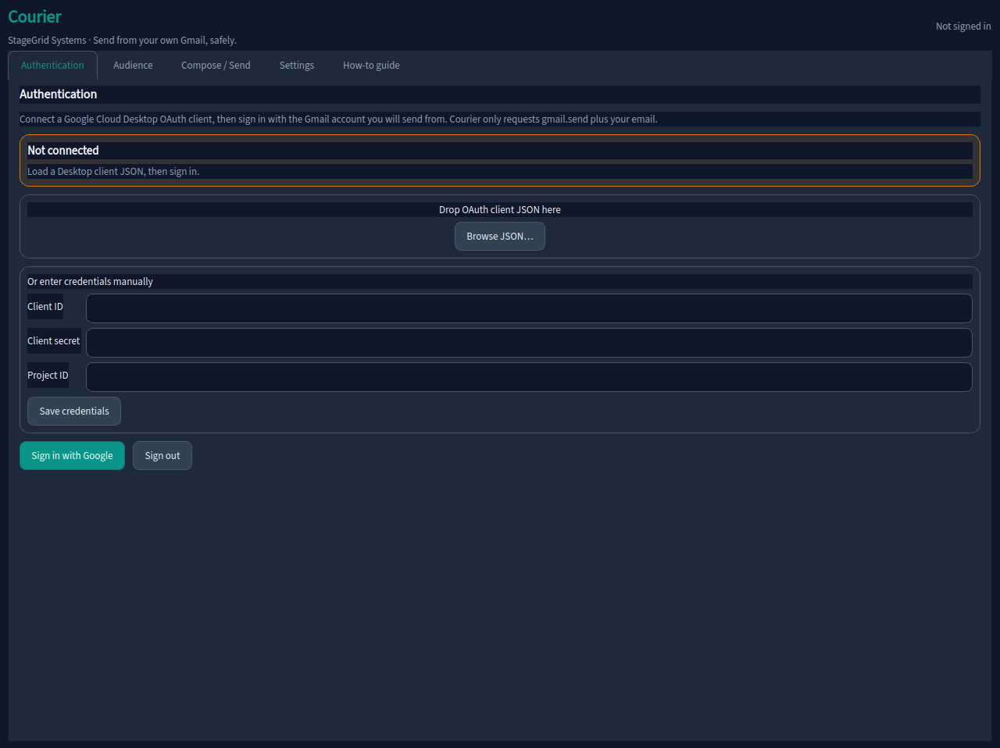
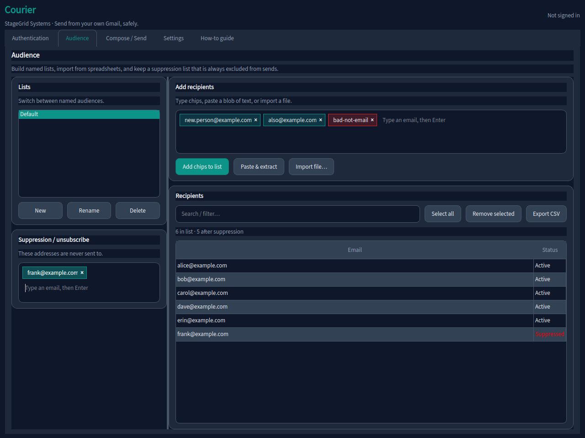
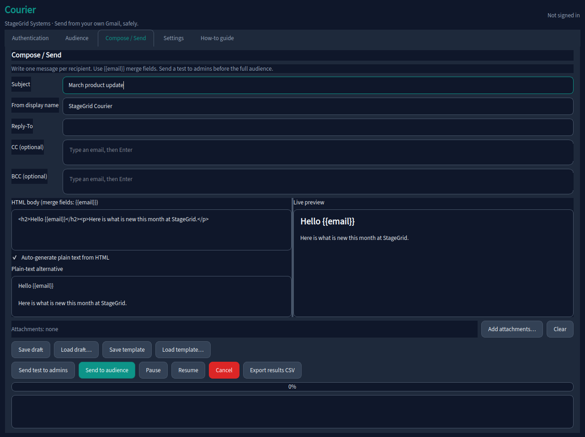
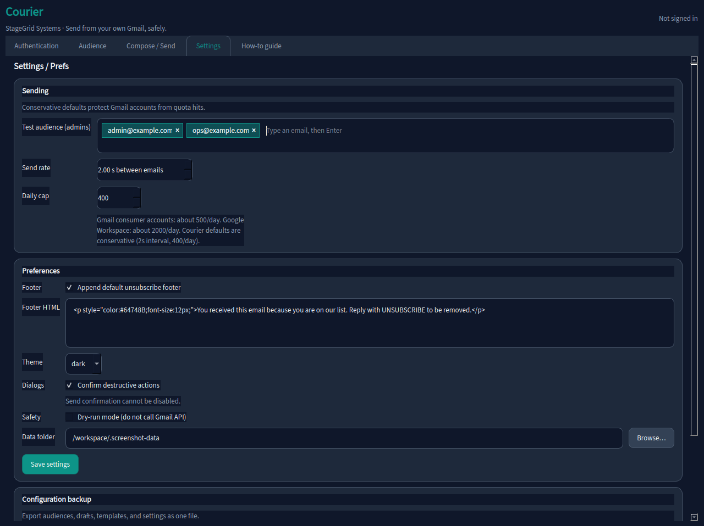
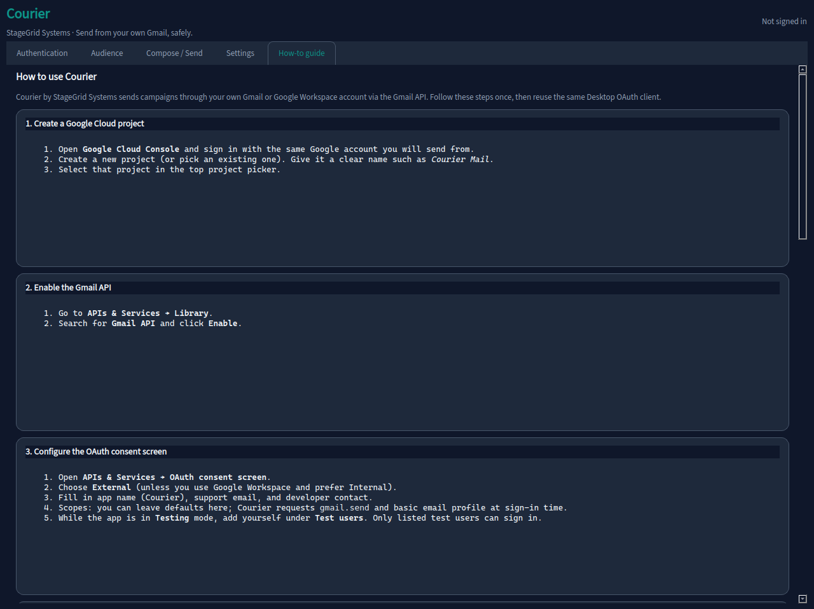
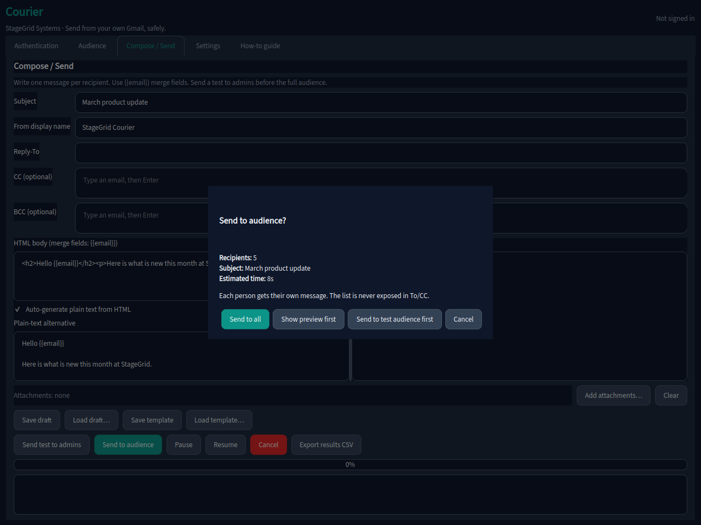

# Courier

**Courier** by **StageGrid Systems** sends email campaigns from *your own* Gmail or Google Workspace account through the Gmail API. One message per recipient. Your list never appears in To or CC.


| | |
| --- | --- |
| Brand | Courier |
| Publisher | StageGrid Systems |
| Palette | Teal `#0D9488` / `#14B8A6` on slate `#0F172A` |
| UI | PySide6 · dark / light theme · IBM Plex / Source Sans stack |

## Screenshots

| Authentication | Audience |
| --- | --- |
|  |  |

| Compose / Send | Settings |
| --- | --- |
|  |  |

| How-to guide | Send confirmation |
| --- | --- |
|  |  |

## Quick start

### Ubuntu

Install Qt runtime packages once:

```bash
sudo apt-get update
sudo apt-get install -y \
  libxcb-cursor0 libxkbcommon-x11-0 libegl1 libgl1 \
  libnss3 libxcomposite1 libxdamage1 libxrandr2 libgbm1 \
  libasound2t64 python3-venv python3-pip
```

Then:

```bash
chmod +x run.sh
./run.sh
```

### Windows

```bat
run.bat
```

Both scripts create a virtualenv, install dependencies, and launch Courier.

### Dev install

```bash
python3 -m venv .venv
source .venv/bin/activate   # Windows: .venv\Scripts\activate
pip install -e ".[dev]"
python -m courier
pytest
ruff check src tests
```

## What it does

1. **Authentication**  -  Desktop OAuth client JSON (or manual client id/secret). Scope: `gmail.send` + account email. Tokens in OS keyring (encrypted file fallback).
2. **Audience**  -  Chip field, paste extract, CSV/XLSX/XLS/TXT (every cell), named lists, suppression list, export.
3. **Compose / Send**  -  HTML + text, `{{email}}` merge fields, attachments (25 MB check), drafts/templates, test-to-admins, confirm modal, queue with pause/resume/cancel, retries, resumable mid-send, results CSV.
4. **Settings**  -  Rate (default 1 email / 2s), daily cap (default 400), theme, dry-run, config export/import (optional encrypted auth).
5. **How-to guide**  -  Google Cloud setup, limits, deliverability, troubleshooting.

## Security notes

- Courier sends as *you*, using OAuth you control. It never asks for your Google password.
- Do not share client secrets or exported configs that include auth.
- Auth-inclusive exports require a password and encrypt secrets with Fernet (PBKDF2-derived key).
- Secrets are not written to the application log.
- Prefer Workspace accounts for business volume. Honor unsubscribes via the suppression list.
- Enable dry-run in Settings when rehearsing without calling Gmail.

## Packaging

```bash
# Linux
./scripts/build_linux.sh

# Windows
scripts\build_windows.bat
```

Uses `packaging/courier.spec` (PyInstaller). Binaries are not committed.

## Screenshots (regenerate)

```bash
QT_QPA_PLATFORM=offscreen python scripts/take_screenshots.py
```

## License

Proprietary. All rights reserved. See [LICENSE](LICENSE).

## Version

See [CHANGELOG.md](CHANGELOG.md). Current: **0.1.0**.
